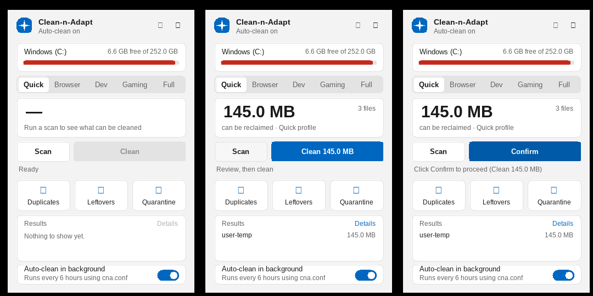

# Clean-n-Adapt (`cna`)

A very small Windows cleaner written in C++17: one command-line tool, plus an optional desktop
widget / tray controller. No Python, Qt, SQLite or other runtime; a hard **125 MB memory cap**.

| Output | Size | What it is |
|---|---|---|
| `Clean-n-Adapt-Setup-<version>.exe` | ~0.9 MB | **The installer. This is the only file you distribute.** |
| `cna.exe` | ~1.5 MB | The engine and command-line interface. Everything real happens here. |
| `cna-widget.exe` | ~0.3 MB | Windows 11 style widget + tray icon. Runs `cna.exe` for every action. |



> Screenshots were captured under Wine (see [docs/TESTING.md](docs/TESTING.md)).
> The empty squares are icon glyphs: Wine has no *Segoe Fluent Icons* font, Windows does.

## What it does

* **Cache cleaning** with profiles: `quick`, `browser`, `dev`, `gaming`, `windows` (admin), `apps`, `custom`, `full`.
* **Duplicate finder** that proves equality (size, then head hash, then full SHA-256), ignores hard links,
  and never reads cloud-only (OneDrive) files. `--of FILE` answers "is there another copy of this file?".
* **Leftovers of removed apps**: folders in AppData / ProgramData / Program Files that no installed app owns,
  scored 0-100; or `--app NAME` to list everything one (already uninstalled) app left behind, including
  registry keys and startup entries (registry is *report-only*).
* **`explain PATH`**: what a folder is, whether it is safe to delete, which installed app owns it; answers
  are remembered in a small searchable knowledge base.
* **Smart advice**: a 192 KB on-device model (no cloud, no LLM) that **learns from your decisions** which folders are safe to clean, explains why, and only ever *moves* things to quarantine. See [docs/MODEL.md](docs/MODEL.md).
* **Debloat**: privacy/ads tweaks, startup items, a short service list, hibernation and preinstalled Store apps, from allow-lists, with a journal so everything except app removal can be undone. See [docs/DEBLOAT.md](docs/DEBLOAT.md).
* **Quarantine**: remnants, duplicates and advisor suggestions are *moved*, not deleted, and can be restored or purged later.
* **Automation**: config file, gating (min hours between runs, free-space trigger), logging, Task Scheduler
  integration, JSON output and exit codes for scripts.
* **Memory cap**: Windows Job Object limit *plus* an internal real-usage guard. 300,000 files peaked at 31 MB.

## Install

Run `Clean-n-Adapt-Setup-<version>.exe` and approve the UAC prompt. It installs system-wide in `Program Files` by default,
registers in *Settings > Apps*, and adds Start Menu entries. It can also add a desktop shortcut and start the widget with
Windows. Installing a newer version upgrades the existing location; uninstalling keeps settings and quarantined files unless
you say otherwise. Silent install: `Clean-n-Adapt-Setup-<version>.exe /S`. Details: [docs/BUILD.md](docs/BUILD.md).

## Quick start

```text
:: start "Clean-n-Adapt" from the Start Menu for the widget, or use the command line (Start Menu > command line):
cna scan --profile quick,browser          preview, never deletes
cna clean --profile quick,browser --yes   delete caches
cna dupes D:\Downloads --min-size 10M     find duplicates
cna remnants                              leftovers of removed apps
cna remnants --app "old game"             what did this app leave behind?
cna recommend                             what could I clean here, and why? (add --apply --yes)
cna debloat scan                          Windows bloat: preview; then: cna debloat apply --preset safe --yes
cna explain "C:\Users\me\AppData\Local\Foo"
cna config init                           write cna.conf
cna auto install --every-hours 6          schedule background cleaning
```

Nothing is deleted without `--yes`. Start with [Getting Started](docs/GETTING_STARTED.md) for the recommended order of operations, then use the [CLI reference](docs/CLI.md) for every command.

## Documentation

| Document | Contents |
|---|---|
| [docs/ARCHITECTURE.md](docs/ARCHITECTURE.md) | Goals, components, data flow, memory design, safety layers, state on disk, design decisions, extension points |
| [docs/GETTING_STARTED.md](docs/GETTING_STARTED.md) | Installation, first-run workflow, common tasks, recovery, automation, and safe debloat guidance |
| [docs/MODEL.md](docs/MODEL.md) | The on-device model: what it learns, the safety gate, measured accuracy and its caveats |
| [docs/DEBLOAT.md](docs/DEBLOAT.md) | Debloat catalogue (tweaks, services, apps), presets, journal and undo, testing status |
| [docs/CLI.md](docs/CLI.md) | All commands and options, built-in cleaning rules, exit codes, JSON output formats |
| [docs/CONFIG.md](docs/CONFIG.md) | `cna.conf` keys, state folder, environment variables, scheduling |
| [docs/SAFETY.md](docs/SAFETY.md) | What is protected, what can go wrong, how to undo things |
| [docs/BUILD.md](docs/BUILD.md) | Building, the installer (what it does, silent flags), versioning, signing, distribution |
| [docs/WIDGET.md](docs/WIDGET.md) | Widget and tray behaviour, how it talks to the CLI, theming |
| [docs/TESTING.md](docs/TESTING.md) | What was verified and what was not, test scripts, a 15-minute Windows checklist |
| [docs/RELEASING.md](docs/RELEASING.md) | Version source, release checklist, CI validation and tagging policy |
| [CHANGELOG.md](CHANGELOG.md) | Release notes |

## Build (source -> installer)

```text
powershell -ExecutionPolicy Bypass -File scripts\build-windows.ps1     :: Windows: CMake + NSIS   -> dist\Clean-n-Adapt-Setup-<ver>.exe
scripts/build-mingw.sh                                                :: Linux/MSYS2: MinGW-w64 + NSIS, no CMake needed
```

Other routes (plain CMake, CMake cross-compile, Linux-native CLI, GitHub Actions) and what the installer does:
[docs/BUILD.md](docs/BUILD.md). The version lives in the `VERSION` file.

## Honest status

**Locally verified on Windows (MSVC, 2026-11-03):** `cna.exe` and `cna-widget.exe` compile successfully; the isolated cache/duplicate/remnant smoke suite passes 19/19.

**Important limits:** the Windows fake-registry test backend is not implemented, so `tests/debloat_check.py` must not be run on a real Windows profile. The installer was not built in this local validation because NSIS was unavailable. The OS-enforced memory cap, registry app inventory, Task Scheduler, tray menu, notifications, DPI scaling, Store-app removal, service changes, `powercfg`, and model accuracy on real machines remain unverified here. Full status and a Windows checklist: [docs/TESTING.md](docs/TESTING.md).

## Licence

No licence has been chosen yet; add a `LICENSE` file before publishing.
