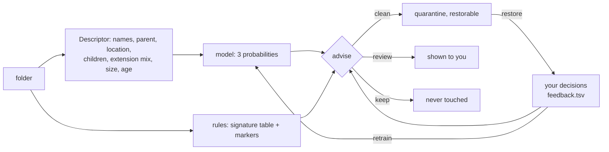

# Architecture

## 1. Goals and constraints

| Goal | Consequence in the design |
|---|---|
| Very light (small binary, small RAM) | C++17, no third-party libraries, static linking, single-threaded CLI, streaming file walks, no database |
| Never exceed 125 MB | Two independent limits (OS-enforced + internal), data structures that grow with *candidates*, not with *files scanned* |
| Safe by default | Dry-run first, protected locations, quarantine instead of delete, no registry writes |
| Scriptable and automatable | Every command has `--json`, stable exit codes, a config file, a scheduler integration |
| GUI without a "formal app" | The widget is a separate tiny process that only launches the CLI |

## 2. Big picture

    +----------------------+      +------------------------+      +------------------+
    |   cna-widget.exe     |      |  Windows Task Scheduler |      |  user / scripts  |
    |   tray + widget      |      |  task "cna-auto"        |      |  cmd, PowerShell |
    +----------+-----------+      +-----------+------------+      +--------+---------+
               | CreateProcess, read stdout   | "cna.exe auto run --quiet"  |
               v                              v                             v
    +------------------------------------------------------------------------------+
    |                                  cna.exe                                     |
    |  main.cpp     argument parsing, global flags, memory cap, dispatch, exit code |
    |  clean.cpp    rules, glob expansion, safe deletion                           |
    |  dupes.cpp    size -> head hash -> SHA-256 pipeline                          |
    |  remnants.cpp installed-app inventory, ownership matching, scoring           |
    |  explain.cpp  signatures, markers, content mix, knowledge base, LLM hook     |
    |  quarantine.cpp  reversible moves + manifest                                 |
    |  autorun.cpp  config, gating, orchestration, scheduler glue                  |
    |  common.cpp   bounded walker, safety predicates, helpers   sha256.hpp        |
    |  platform.cpp OS layer (Windows implementation + POSIX shim)                 |
    +------+---------------------------+-----------------------------+-------------+
           | filesystem                | registry (read only)        | state directory
           v                           v                             v
      caches, user files        Uninstall keys, AppX list     cna.conf  state.txt  cna.log
                                                              kb.tsv  quarantine/

The widget never scans anything itself. This is the central design decision: one engine, three front-ends (CLI,
widget, scheduler), one place where safety and memory rules are enforced.

## 3. Source map

| File | Responsibility |
|---|---|
| `src/main.cpp` | Parses global flags, sets `G` (global context), applies the memory cap, dispatches commands, maps exceptions to exit codes (`CapExceeded`/`bad_alloc` -> 3). |
| `src/common.hpp/.cpp` | Strings/format helpers, path normalisation, `is_protected`, `is_excluded`, state-dir resolution, time helpers, `tick()/check_mem()`, the bounded directory `walk()`, `tree_info()`, argument parser. |
| `src/platform.hpp/.cpp` | Everything OS specific (see section 11). |
| `src/clean.cpp` | Built-in rule table, `${ENV}`/wildcard expansion, target resolution, recursive cleaning, `clean`/`scan` commands. |
| `src/dupes.cpp` | Duplicate pipeline, `--of` mode, keeper selection, quarantine of extras. |
| `src/remnants.cpp` | `OwnerIndex`, leftover scoring, `--app` search, quarantine of leftovers. |
| `src/explain.cpp` | Folder signatures, marker detection, content mix, knowledge base (`kb.tsv`), `explain`/`kb` commands. |
| `src/model.hpp/.cpp` | Folder descriptor, hashed features, softmax model, built-in seed, feedback store, `advise()` safety gate, `model` command. |
| `src/recommend.cpp` | `cna recommend`: recursive advisor, quarantine of suggestions. |
| `src/debloat.cpp` | Tweak/service/app/startup catalogues, scan, apply, journal, undo. |
| `src/llm_stub.cpp` | Default (empty) local-LLM backend; the swap-in point. |
| `src/quarantine.cpp` | `q_move`, `q_purge`, manifest, `quarantine` command. |
| `src/autorun.cpp` | Config parser, gating, `auto run/install/remove/status`, `config` command. |
| `src/sha256.hpp` | Streaming SHA-256. |
| `widget/widget.cpp` | The whole widget (Win32 + GDI+), ~1000 lines. |

## 4. Execution model

* The CLI is **single-threaded**. Every command is a straight-line pipeline that streams the filesystem.
* Global state is one struct, `Ctx G` (flags, memory cap, excludes). There is no other mutable global of note
  besides the custom-rule list and the state-dir cache.
* Output is either human text or JSON (`--json`), never both. Progress/warnings go to `stderr`.
* Errors are returned as exit codes (table in `CLI.md`); exceptions are used only for the memory guard and
  truly unexpected failures.

## 5. Memory design (the 125 MB cap)

### 5.1 Two layers of enforcement

1. **OS limit** (`plat::apply_mem_cap`). Windows: a Job Object with `JOB_OBJECT_LIMIT_PROCESS_MEMORY`; the kernel
   fails any allocation beyond the cap, which surfaces as `std::bad_alloc`. POSIX shim: `RLIMIT_DATA`.
   If the process is already in a restrictive job and assignment fails, `cna` prints a warning and relies on layer 2.
2. **Internal budget** (`tick()` / `check_mem()`). Every walker step calls `tick()`; every 2048 calls it reads the
   process's real private bytes and throws `CapExceeded` above **90 %** of the cap, so the tool stops *cleanly*
   (exit code 3, a message saying how to narrow the scan) before the OS limit is hit.

### 5.2 Why usage stays small

| Feature | What is held in memory | Growth |
|---|---|---|
| Directory walk | A stack of pending directory paths | proportional to tree *depth x fan-out*, not file count |
| Cache clean | Counters only (files are deleted as they are visited) | constant |
| Duplicates, pass 1 | `unordered_map<size, count>` | one entry per *distinct file size* |
| Duplicates, pass 2 | Paths of files whose size occurs more than once, in one string arena + 16-byte records | proportional to *size-collision candidates*; map is freed before hashing |
| Hashing | One 64 KB buffer | constant |
| Leftovers | Installed-app index + one `TreeInfo` at a time (capped at 20,000 entries per folder) | proportional to installed apps |
| Knowledge base | Streamed line by line; rewritten via a temp file; capped at 50,000 rows | constant |
| Quarantine manifest | Whole manifest loaded (small) | proportional to quarantined items |

Measured: duplicate search over 300,000 files peaked at ~31 MB (see `TESTING.md`).

### 5.3 What the cap does *not* cover

`cna-widget.exe` is a separate process. It is small (GDI+ plus a few buffers) and is not job-limited, but every
`cna.exe` it launches is capped individually. Limits set via `cna.conf` (`mem_cap_mb`) can only *lower* the cap
given on the command line.

## 6. Safety architecture

Defence in depth, from outermost to innermost:

1. **Preview by default** - `scan` can never delete; `clean` deletes only with `--yes`.
2. **Rule-bounded targets** - cleaning acts only on directories produced by the rule table (or `custom_rule`s).
3. **Protected locations** (`is_protected`) - refuses any target that is shallower than two path components,
   equals, *or contains*, a protected directory (user profile, AppData, Local/Roaming, Program Files, ProgramData,
   Windows, system drive root, Desktop/Documents/Downloads/Pictures/Videos/Music/OneDrive). Applied *before*
   de-duplicating nested targets so a hostile broad rule cannot shadow legitimate ones.
4. **User excludes** (`--exclude`, `exclude =`) - honoured by the walker, the cleaner and the quarantine.
5. **Link discipline** - symlinks and junctions are never followed or deleted; cloud-placeholder files are never read.
6. **Minimum age** - files modified within the rule's / `--min-age` window are kept.
7. **Reversibility** - leftovers and duplicates go to quarantine; only quarantine retention purges permanently.
8. **Read-only registry** - the registry is read for the app inventory and `--app` reports, never modified.
9. **No self-elevation** - rules that need administrator rights are skipped (and reported) when not elevated.

Details for users: `SAFETY.md`.

## 7. Cache cleaner (`clean.cpp`)

    parse profiles -> mask
    rules = builtin_rules() + custom rules
    for rule in rules where rule.mask & mask:
        skip (report) if rule.admin and not elevated
        for path in expand_pattern(rule.pattern):         # ${ENV} + per-segment * ?
            skip if excluded; skip+warn if protected
            targets += path
    drop targets nested inside another target, drop duplicates
    for target in targets: clean_tree(target, min_age, apply)

* **Pattern expansion** splits on `/`, substitutes `${VAR}` from the environment (an unset variable drops the rule),
  keeps a literal prefix, then walks wildcard segments (`*`, `?`, case-insensitive) level by level. A pattern whose
  final segment matches files (e.g. `thumbcache_*.db`) yields file targets.
* **`clean_tree`** iterates a directory, recurses into sub-directories (max depth 48), removes eligible files,
  removes sub-directories that end up empty, and counts files that fail to delete (in use) instead of aborting.
  In dry-run it performs the identical traversal without removing anything, so preview and real run agree.
* **Rule data** is a table of `{id, profile mask, pattern, needs-admin, default min age, note}`; adding a rule is one line.

## 8. Duplicate finder (`dupes.cpp`)

    pass 1  walk roots  -> sizes[size]++                       (no paths stored)
    pass 2  walk roots  -> keep path only if sizes[size] >= 2  (arena + 16-byte records), free map
    sort candidates by size
    for each same-size group:
        stage 1: SHA-256 of first 16 KB   -> bucket
        stage 2: for buckets >= 2, SHA-256 of whole file -> bucket        (files <= 16 KB reuse stage 1)
        within a bucket: drop entries sharing a physical file id (hard links)
        >= 2 distinct physical files  -> DuplicateSet
    sort sets by wasted bytes (descending)

* Cost: every file is stat'ed twice, but only size-collision candidates are read, and most are rejected by the
  16 KB head hash without a full read.
* **Keeper** = oldest modification time, ties broken by shorter path. Everything else is "extra".
* **Hard links** share a `FileId` (volume serial + index on Windows, dev + inode on POSIX) and are counted once, so
  removing a link is never reported as reclaimable space.
* **Default skips**: `.git`, `node_modules`, `$Recycle.Bin`, `System Volume Information`, `Windows`, `WinSxS`,
  `Program Files`, `Program Files (x86)`, `ProgramData` (disable with `--no-skip`).
* **`--of FILE`** hashes one file and scans roots for same-size files, comparing hashes.

SHA-256 (rather than a faster non-cryptographic hash) is used so that "identical" is a statement you can rely on
before a file is moved; collisions are not a practical concern.

## 9. Leftover detection (`remnants.cpp`)

### 9.1 Inventory
Windows: the three `Uninstall` registry views (HKLM 64/32-bit, HKCU) giving name, publisher, alias (key name),
install location (or the folder of `DisplayIcon`), plus Store (AppX) package names. `--apps-file` can supply the
same data from a file (`name|publisher|install_dir` per line) - used for testing and non-Windows development.

### 9.2 Ownership matching (`OwnerIndex`)
For each candidate folder, in order of confidence:
1. its path equals / contains / is inside an app's install location;
2. its normalised name (lower-case alphanumerics) equals a name derived from an app (name, publisher, alias,
   install-folder name, first word, first two words);
3. substring relation with such a name (both >= 5 characters);
4. any shared *significant* token (stop-words such as "update", "launcher", "windows", "microsoft" are ignored).

Any match means "owned". The matching is deliberately generous: a missed leftover costs a few MB, a wrongly flagged
live folder costs a user's trust.

### 9.3 Scoring
Candidates are the immediate sub-folders of `%LOCALAPPDATA%`, `%LOCALAPPDATA%\Programs`, `%APPDATA%`,
`%PROGRAMDATA%`, `%PROGRAMFILES%`, `%PROGRAMFILES(X86)%`, excluding well-known system names.

| Evidence | Score |
|---|---|
| base: no installed app matches | 55 |
| folder contains no files | +15 |
| newest file older than 365 days | +25 |
| ... older than 180 days | +15 |
| ... older than 90 days | +5 |
| ... modified within 30 days | -25 |
| Program Files folder with an uninstaller but no registry entry (`program-files-orphan`) | -5 |
| Program Files folder with executables, no uninstaller (`unregistered-program`, may be portable) | -20 |

Scores are clamped to 0-100. `remnants` shows >= 65 by default, `auto` uses `remnants_min_score` (default 75).
Folder statistics stop after 20,000 entries (shown as `+` after the size).

### 9.4 `--app NAME`
Searches (default depth 3; depth 1 in the profile root) AppData, ProgramData, Program Files, Temp, the profile
root and Start Menu program folders for names containing the term, and - on Windows - registry keys two levels deep
under `HKCU\Software`, `HKLM\SOFTWARE`, `HKLM\SOFTWARE\WOW6432Node`, plus `Run` values. Registry results are
report-only. Moving files to quarantine is refused while the app still appears in the installed-app list.

## 10. Identification and knowledge base (`explain.cpp`)

Classification is layered, cheapest first:

1. **Signature table** keyed by folder name (about 50 entries: `node_modules`, `.git`, `Cache`, `GPUCache`,
   `WinSxS`, `.ssh`, `steamapps`, ...). Each has a kind, a safety class and a one-line explanation.
2. **Marker files** inside the folder (`package.json`, `Cargo.toml`, `CMakeLists.txt`, `.git`, `Local State`,
   `prefs.js`, an uninstaller executable, ...).
3. **Build-output rule**: `dist/build/target/out/obj/bin` next to a project file is `regenerable`.
4. **Content mix** from a file-extension histogram (e.g. "mostly video (82 % by size)").
5. **Ownership** via `OwnerIndex`.
6. **Knowledge base**: used only when layers 1-3 say "unknown"; answers with a known kind are saved after each run.
7. **Optional LLM** (`--llm`), only for still-unknown folders (section 15).

Safety classes: `regenerable` (rebuilt automatically), `caution` (may hold data), `keep`, `unknown`.

`kb.tsv` columns: `key (normalised path) | kind | safety | summary | source | epoch | display path`, tab-separated with
`\t \n \\` escaping. Lookups stream the file (last entry wins); writes rebuild it through a temp file and drop the
oldest rows beyond 50,000.

## 11. Platform layer (`platform.cpp`)

| Function | Windows | POSIX shim (dev/test) |
|---|---|---|
| `env` | `GetEnvironmentVariableW` -> UTF-8 | `getenv` |
| `utf8_args` | `CommandLineToArgvW` | argv |
| `apply_mem_cap` | Job Object, `ProcessMemoryLimit` | `setrlimit(RLIMIT_DATA)` |
| `private_bytes` | `GetProcessMemoryInfo().PrivateUsage` | `/proc/self/statm` resident |
| `is_elevated` | token elevation | `geteuid()==0` |
| `is_reparse_dir` | `FILE_ATTRIBUTE_REPARSE_POINT` | false |
| `is_cloud_placeholder` | OFFLINE / RECALL_ON_OPEN / RECALL_ON_DATA_ACCESS | false |
| `file_id` | `GetFileInformationByHandle` | `stat` dev/inode |
| `installed_apps` | Uninstall keys + AppX repository | empty (use `--apps-file`) |
| `registry_find` | recursive key-name / Run-value search | empty |
| `reg_get/reg_set/reg_delete_value/reg_values/reg_key_exists` | Win32 registry (HKCU/HKLM; DWORD, string, binary) | file-backed fake (`CNA_FAKE_REGISTRY`) |
| `appx_full_names` | AppX repository key names | `CNA_FAKE_APPX` file |
| `run_command` | `cmd /c` with captured output | records to `CNA_FAKE_EXEC`, never executes |
| `schedule_*` | `schtasks.exe` | "not supported" |
| `exe_path` | `GetModuleFileNameW` | `/proc/self/exe` |

All text is UTF-8 inside the program; the Windows layer converts at the boundary and the console is switched to
code page 65001.

## 12. Quarantine (`quarantine.cpp`)

    <state>/quarantine/index.tsv                    id | original path | epoch | bytes | reason   (escaped TSV)
    <state>/quarantine/<id>/<original file name>    the moved item
    id = YYYYMMDD-HHMMSS-<n>

`q_move` renames; if that fails (typically another volume) it copies, then deletes the original only if the copy
succeeded, otherwise it removes the partial copy and reports the failure. `restore` refuses to overwrite an existing
path. `purge` requires `--yes`. `auto run` purges items older than `quarantine_keep_days`.

## 13. Automation (`autorun.cpp`)

`auto run`: load config -> apply excludes / custom rules / memory cap -> gating (`min_hours_between_runs`,
`free_below_percent`, bypass with `--force`) -> clean -> leftovers (report | quarantine) -> duplicates
(report | quarantine) -> purge old quarantine -> write `state.txt` and one line to `cna.log` (rotated at 256 KB).
`--dry-run` performs every step except changes and bookkeeping. Scheduling is delegated to Task Scheduler via
`schtasks` (task name `cna-auto`, command `"cna.exe" auto run --quiet`).

## 14. State directory

Resolved in order: `--state DIR`, `CNA_HOME`, `<exe folder>\.state` **only if that folder already exists** (portable mode: create it to opt in),
then `%LOCALAPPDATA%\cna` (the normal, installed case), `$XDG_STATE_HOME/cna`, `~/.local/state/cna`. Keeping data outside the program folder is
deliberate: quarantined files, the model and the debloat journal must survive upgrades and uninstalls. The widget uses the same rule for `widget.ini`.

| File | Written by | Purpose |
|---|---|---|
| `cna.conf` | `config init`, `auto install` | automation configuration |
| `state.txt` | `auto run` | `last_run`, `last_freed` |
| `cna.log`, `cna.log.1` | `auto run` | run history (rotated at 256 KB) |
| `kb.tsv` | `explain` | knowledge base |
| `quarantine/` | `dupes`, `remnants`, `auto` | quarantined items and manifest |
| `widget.ini` | widget | position, pin, profile, visibility |
| `model.bin` | `model` (first use) | the folder model (196,640 bytes) |
| `feedback.tsv` | `model feedback`, quarantine restore | your decisions, replayed on every retrain |
| `debloat-journal.tsv` | `debloat apply` | previous values, for `debloat undo` |

## 15. Widget architecture (`widget/widget.cpp`)

### 15.1 Process model
One UI thread owns the window, tray icon and all state. Each action creates a short-lived worker thread that
launches `cna.exe` with piped stdout (stderr and stdin to `NUL`, no console window), reads the output (capped at
16 MB), waits for exit, then posts `WM_JOB_DONE` carrying the result to the UI thread. Only one foreground job runs
at a time; the startup `auto status` query is a *silent* job that never locks the UI. **Stop** terminates the
foreground child.

### 15.2 Result handling
The widget parses `cna --json` with a few tolerant readers (`kpos/numat/strat/nth_str`) because the output schema is
flat and under our control. It extracts totals, the top three rows for the Results list, and builds the contextual
primary action (`Clean <size>`, `Quarantine extras`, `Quarantine leftovers`). "Details" re-runs the same command in
text mode and opens the report in the default text editor.

### 15.3 Rendering
Custom-drawn with GDI+ into an off-screen 32-bit bitmap, then blitted (no flicker). Layout is defined in
device-independent pixels (340 x 516) and multiplied by the monitor DPI scale. Controls are rectangles in a button
table (hit-testing, hover/pressed states, enabled rules) rather than OS controls, which gives full control over the
Windows 11 look at very low cost.

Windows 11 integration: `DWMWA_WINDOW_CORNER_PREFERENCE` (rounded), `DWMWA_BORDER_COLOR`, a 1 px frame extension
for the shadow, `AppsUseLightTheme` + `DWM\AccentColor` from the registry, `WM_SETTINGCHANGE` for live theme
switching, `WM_DPICHANGED` for per-monitor DPI, `TaskbarCreated` to restore the tray icon after an Explorer restart.
Tray menus opt in to dark mode through the (undocumented) uxtheme ordinals 135/136; if they are missing the menu
simply stays light. Fonts: Segoe UI Variable -> Segoe UI -> generic sans; icons: Segoe Fluent Icons -> Segoe MDL2
Assets.

### 15.4 Primary-button state machine

    idle, nothing pending --> "Clean" (disabled)
    after Scan, bytes > 0 --> "Clean <size>"        --click--> "Confirm" (5 s) --click--> run, "Stop"
    after Duplicates       --> "Quarantine extras"   (same confirm flow)
    after Leftovers        --> "Quarantine leftovers" (same confirm flow)
    any job running        --> "Stop"

## 16. Design decisions and trade-offs

| Decision | Reason | Cost |
|---|---|---|
| Widget as a separate process that shells out to the CLI | One engine; GUI cannot bypass safety or the cap; CLI stays testable | ~tens of ms per action; a missing `cna.exe` breaks the widget |
| No SQLite / no JSON library | Binary size, build simplicity | Hand-rolled TSV state, tiny purpose-built JSON readers |
| Quarantine instead of delete for leftovers/duplicates | Heuristics can be wrong | Space is freed only after purge (default 30 days in `auto`) |
| Registry is read-only | Registry "cleaners" are the classic way to break a system | Stale registry entries are reported, not removed |
| Generous ownership matching | Avoid flagging live data | Some real leftovers are not flagged |
| Folder identification by rules + KB rather than an embedded model | A usable model does not fit beside a 125 MB cap | Unknown folders get a generic answer |
| Static, unsigned executables | Single-file deployment, no runtime dependency | SmartScreen warning until signed |
| Custom-drawn GDI+ UI | Tiny, no DLL dependencies, full visual control | No screen-reader/accessibility tree like native controls; no Mica backdrop |

## 17. Extension points

* **New cleaning rule** - add one `add("id", PROFILE, "${ENV}/path/*/Cache", min_age_days, needs_admin, "note")` line in
  `builtin_rules()` (`clean.cpp`). No other change is needed.
* **New folder signature** - add an entry to `SIGS[]` in `explain.cpp`.
* **Local LLM** - implement `cna::llm::available()` and `cna::llm::describe(facts)` (see `llm_stub.cpp`). Call it only
  after scanning has finished so the model and the scanner never share the cap; `explain --llm` already calls it
  only for folders that remain "unknown". A quantised model of roughly 100 M parameters is the realistic ceiling
  for this cap; this path is **not implemented or tested**.
* **New command** - declare it in `cmds.hpp`, implement it in its own `.cpp`, add one line to the dispatch in `main.cpp`.
* **New front-end** - consume `cna <command> --json`; the schemas are listed in `CLI.md`.

## 18. Known limitations

* Windows-specific code paths have been cross-compiled and exercised under Wine but not yet run on real Windows.
* Duplicate detection is per file; whole duplicate *folders* are not recognised as such.
* The Recycle Bin and Windows' built-in cleanup (Disk Cleanup, component store) are not touched.
* Scheduled runs use a per-user task; they typically run while the user is signed in.
* The widget does not use a Mica/Acrylic backdrop; it uses solid Windows 11 colours.
* The model is trained on a synthetic seed written by the author and has not been evaluated on real machines (see MODEL.md section 6). Generic folder names (for example `Data`) are only ever `review`.
* Debloat: the PowerShell app removal, service changes, `powercfg` and Windows 11 protected values are untested on real Windows (DEBLOAT.md section 9).

## 19. Learning and advice (`model.cpp`, `recommend.cpp`)

A 192 KB softmax-regression model (3 classes x 16,384 hashed features, trained by SGD in ~70 ms, no dependencies) predicts whether a folder is
`regenerable`, `caution` or `keep`. It learns from a built-in synthetic seed plus the user's own decisions (explicit `model feedback`,
and every restore from quarantine). The model only **proposes**: `advise()` applies a non-learned gate (sensitive names never cleaned, a cache-like name
required for `clean`, the user's decision always first) and the deterministic rules stay authoritative where they know the folder.
`cna recommend` walks AppData / ProgramData, descends into "review" folders to find caches several levels down, reports each byte once at the most
specific folder, and applies suggestions only by moving them to quarantine. Full description, measured accuracy and its caveats: [MODEL.md](MODEL.md).

## 20. Debloat (`debloat.cpp`)

Catalogue-driven (allow-lists in the source), not model-driven. Five categories: privacy registry values, startup items (the Task Manager
`StartupApproved` marker), a short list of services, hibernation, and an allow-list of Store apps (the only irreversible one, opt-in).
Every change records the previous value in `debloat-journal.tsv`; `debloat undo` restores it exactly. It talks to the registry through the
platform layer (`reg_get/reg_set/...`), which on POSIX is a file-backed fake so the logic is fully testable on Linux. See [DEBLOAT.md](DEBLOAT.md).
