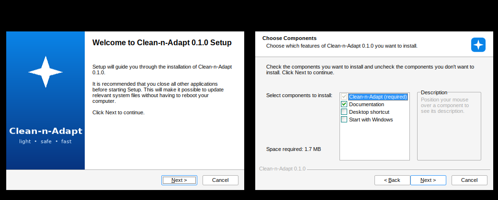

# Building and releasing

Everything is built from this source tree. The result you distribute is **one file**:
`dist/Clean-n-Adapt-Setup-<version>.exe` (about 0.7 MB). Nothing else needs to be shipped.

## 1. What a build produces

| Output (in `dist/`) | What it is |
|---|---|
| `Clean-n-Adapt-Setup-0.1.0.exe` | The installer (NSIS). **This is what you give to users.** |
| `cna.exe`, `cna-widget.exe` | The two programs, also available loose for testing. |

The version comes from the one-line file `VERSION` (three numbers, e.g. `0.1.0`). It is injected into the exes
(`cna version`, Explorer > Properties > Details) and the installer file name. To release: edit `VERSION`, add a
`CHANGELOG.md` entry, rebuild.

## 2. Pick one way to build

### A. Windows with CMake (recommended on Windows)

```text
winget install Kitware.CMake
winget install NSIS.NSIS
:: plus a compiler: Visual Studio Build Tools ("Desktop development with C++")  or  MinGW-w64
powershell -ExecutionPolicy Bypass -File scripts\build-windows.ps1
```

`cmake --build` also builds the installer automatically whenever `makensis` is found (the `installer` target is part
of `ALL`). Without NSIS it prints a warning and still builds the exes. *MSVC path: written, not yet compiled.*

### B. MinGW-w64 + NSIS without CMake (Linux, macOS, or MSYS2)

```text
sudo apt install g++-mingw-w64-x86-64-posix nsis        # Debian/Ubuntu;  MSYS2: pacman -S mingw-w64-x86_64-gcc mingw-w64-x86_64-nsis
scripts/build-mingw.sh
```

This is the route used to build and test the project during development (cross-compiled on Linux).

### C. CMake cross-compile on Linux

```text
cmake -S . -B build-win -DCMAKE_TOOLCHAIN_FILE=cmake/mingw-w64-x86_64.cmake
cmake --build build-win
```

### D. Linux-native CLI only (development and tests)

```text
cmake -S . -B build && cmake --build build      # or: g++ -std=c++17 -Os -o cna src/*.cpp
python3 tests/smoke.py ./build/cna
```

### E. GitHub Actions

`.github/workflows/build.yml` builds on a Windows runner on every push and attaches the installer as a downloadable
artifact. (Not run yet; it first runs when the project is pushed to GitHub.)

## 3. What the installer does



> Captured under Wine (see [TESTING.md](TESTING.md)); real Windows draws the same pages with native fonts.

* **Per-user, no administrator rights, no UAC prompt.** Default folder: `%LOCALAPPDATA%\Programs\Clean-n-Adapt`
  (changeable on the folder page; an earlier install location is remembered for upgrades).
* Installs `cna.exe`, `cna-widget.exe`, `README.md`, `CHANGELOG.md` and, optionally, `docs\`.
* Start Menu folder: *Clean-n-Adapt* (widget), *command line* (opens a prompt with `cna help`), *documentation*, *Uninstall*.
* Optional components (off by default): **Desktop shortcut**, **Start with Windows** (writes the same
  `HKCU\...\Run\cna-widget` value the widget's tray menu toggles).
* Registers in **Settings > Apps > Installed apps** with version, size and a quiet-uninstall command.
* **Upgrades in place:** install a newer setup over an older one. A running widget is asked to exit first
  (`cna-widget.exe --quit`) so its file can be replaced; settings and quarantine are untouched.
* **Uninstall** removes the program, shortcuts, the `cna-auto` scheduled task, the Run value and the Apps entry.
  It **keeps** `%LOCALAPPDATA%\cna` (settings, knowledge base, log and **quarantined files**) unless you answer *Yes* to the
  explicit question; a silent uninstall always keeps it. A `.state` folder beside the exe (portable mode) is never removed.

Silent (unattended) use, e.g. for deployment scripts:

```text
Clean-n-Adapt-Setup-0.1.0.exe /S                       install with defaults
Clean-n-Adapt-Setup-0.1.0.exe /S /D=D:\Tools\cna       custom folder (/D must be the last argument)
"%LOCALAPPDATA%\Programs\Clean-n-Adapt\Uninstall.exe" /S
```

## 4. Customising

| Want to change | Where |
|---|---|
| Publisher / copyright text shown in Apps and file properties | `!define PUBLISHER` in `installer/cna.nsi` (and the `ProductName` strings in `assets/*.rc`) |
| Icon and installer artwork | Edit `tools/make_icon.py`, run `python3 tools/make_icon.py` (needs Pillow); outputs `assets/cna.ico`, `assets/installer-side.bmp` |
| Add a licence page to the wizard | Add `!insertmacro MUI_PAGE_LICENSE "${ROOT}/LICENSE"` before the components page in `installer/cna.nsi` (after you choose a licence) |
| Add `cna` to your PATH | Not done on purpose (editing PATH safely needs a plugin); add the install folder manually or use the Start Menu command-line shortcut |
| Built-in cleaning rules | `builtin_rules()` in `src/clean.cpp` |
| Widget look and layout | `layout()` and `paint()` in `widget/widget.cpp` (dp units, scaled by DPI) |

## 5. Distributing

* Give people only the `Clean-n-Adapt-Setup-<version>.exe`. Publish its SHA-256 next to it
  (`certutil -hashfile Clean-n-Adapt-Setup-0.1.0.exe SHA256`) so downloads can be verified.
* The installer and exes are **unsigned**, so Windows SmartScreen shows "Windows protected your PC" on first run
  (More info > Run anyway). Removing that needs a code-signing certificate and `signtool sign` on the installer *and*
  both exes; it is not set up here.
* Antivirus products sometimes flag unsigned programs that delete files. Signing and a stable download location help.
