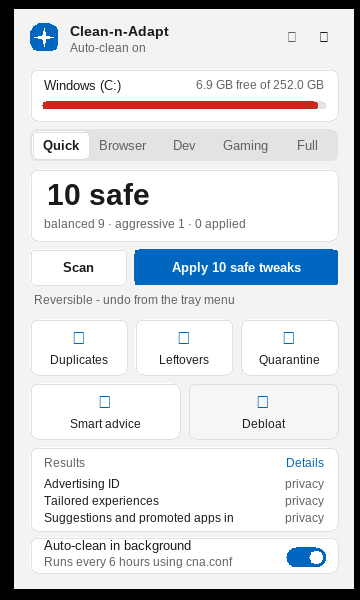

# Debloat

`cna debloat` removes the "extra" parts of Windows: advertising and suggestions, noisy startup items, a short list of
non-essential services, and preinstalled Store apps. It is deliberately **catalogue-driven, not model-driven**: removing
system pieces must be an explicit allow-list you can read and audit, so nothing outside the lists below can be touched by a preset.



> Screenshot captured under Wine.

## 1. Principles

1. **Preview first.** `scan` changes nothing; `apply` without `--yes` is a dry run.
2. **Allow-lists only.** Every tweak, service, app and startup hint is a line in `src/debloat.cpp`.
3. **Everything but Store apps is undoable.** Before each change the previous value (or its absence) is written to a journal;
   `cna debloat undo` restores exactly that.
4. **Store apps need explicit opt-in** (`--apps`), because that is the one change this tool cannot reverse.
5. **Security software and drivers are never offered.**
6. **No registry "cleaning".** Only the named values below are written; nothing is deleted from the registry except values the tool itself created (on undo).

## 2. What it can change

| Category | What | Scope | Admin | Undo |
|---|---|---|---|---|
| `privacy` | Registry values: ads, suggestions, telemetry level, search, taskbar buttons | per user (HKCU) or policy (HKLM) | HKLM items only | yes |
| `startup` | Disables Run-key and Startup-folder entries the way Task Manager does (`StartupApproved`) | per user | no | yes |
| `services` | Sets a short list of services to Disabled | machine | yes | yes (takes effect after restart) |
| `disk` | Turns hibernation off (frees `hiberfil.sys`) | machine | yes | yes (`powercfg /hibernate on`) |
| `apps` | Removes preinstalled Store apps for your account | per user | no | **no** (reinstall from the Store) |

## 3. Presets

| Preset | Includes |
|---|---|
| `safe` (default) | tier-1 items: nothing most people would notice losing |
| `balanced` | tier 1 + 2: small functional changes (web results in Start search, Widgets button, launchers at startup) |
| `aggressive` | tier 1 + 2 + 3: real trade-offs (Game Bar capture, Windows Search indexing, Xbox services, OneDrive/Dropbox at startup, hibernation) |

By default a preset applies `privacy`, `startup`, `services` and `disk`. **Apps are never part of a default run**: add `--apps`
or `--only apps`. Use `--id ID` (repeatable) to apply specific items regardless of preset.

## 4. The catalogue

### 4.1 Privacy and ads (registry)

| Id | What it does | Cost | Tier | Admin |
|---|---|---|---|---|
| `tw:ads-id` | Advertising ID: Apps can no longer use a per-user advertising ID. | Ads become less relevant. | safe | no |
| `tw:tailored` | Tailored experiences: Stops using diagnostic data to personalise tips and ads. | Less personalised suggestions. | safe | no |
| `tw:start-ads` | Suggestions and promoted apps in Start: Removes tips, suggested apps and promotions from Start and Settings. | None for most people. | safe | no |
| `tw:silent-installs` | Silent promoted-app installs: Stops Windows quietly installing promoted apps in the background. | None. | safe | no |
| `tw:lockscreen-tips` | Lock screen tips: Removes fun facts, tips and ads from the lock screen. | None. | safe | no |
| `tw:explorer-ads` | Ads in File Explorer: Hides sync-provider promotions in File Explorer. | None. | safe | no |
| `tw:feedback` | Feedback prompts: Stops Windows asking you for feedback. | None. | safe | no |
| `tw:search-highlights` | Search highlights: Removes the daily doodles/ads from the search box. | None. | safe | no |
| `tw:consumer-features` | Consumer features (all users): Stops Windows installing consumer apps and suggestions for every account. | Only applies to Pro/Enterprise/Education editions. | safe | yes |
| `tw:start-recs` | Start 'Recommended' section: Stops Start suggesting recent files and apps (Windows 11). | Start shows fewer shortcuts. | balanced | no |
| `tw:bing-search` | Web results in Start search: Search finds only your PC, not Bing results. | No web results when searching from Start. | balanced | no |
| `tw:track-progs` | Track launched apps: Stops Windows tracking which apps you launch for Start. | Start's 'most used' list stops updating. | balanced | no |
| `tw:taskbar-widgets` | Taskbar Widgets button: Hides the Widgets button/news feed (Windows 11). | No widgets panel. May be ignored on the newest builds. | balanced | no |
| `tw:taskbar-chat` | Taskbar Chat button: Hides the Chat/Teams button (Windows 11). | None. May be ignored on the newest builds. | balanced | no |
| `tw:copilot` | Windows Copilot: Turns off the Copilot side panel by policy. | No Copilot. Policy is ignored on some newer builds. | balanced | no |
| `tw:telemetry-min` | Diagnostic data level: Asks Windows to send only the minimum required diagnostic data. | Home edition treats this as 'Required'. A few Insider features need more. | balanced | yes |
| `tw:activity-history` | Activity history: Stops collecting and uploading your activity history (Timeline). | No cross-device activity history. | balanced | yes |
| `tw:game-dvr` | Game DVR / background recording: Turns off Game Bar background capture. | No Game Bar clips or recording. | aggressive | no |

### 4.2 Services (all need administrator; effective after a restart)

| Service | Name | Tier | Cost |
|---|---|---|---|
| `RetailDemo` | Retail Demo Service | safe | None (only used on store demo PCs). |
| `Fax` | Fax | safe | None unless you use a fax modem. |
| `DiagTrack` | Connected User Experiences and Telemetry | balanced | Less diagnostic data is sent to Microsoft. |
| `dmwappushservice` | WAP Push Message Routing | balanced | None for most PCs. |
| `MapsBroker` | Downloaded Maps Manager | balanced | Offline maps in the Maps app stop updating. |
| `WerSvc` | Windows Error Reporting | aggressive | Crash reports are no longer sent or collected. |
| `SysMain` | SysMain (Superfetch) | aggressive | May slow app launches on hard disks (negligible on SSDs). |
| `WSearch` | Windows Search indexing | aggressive | File and Outlook search become slower. |
| `XblAuthManager` | Xbox Live Auth Manager | aggressive | Xbox app, Game Pass and some Store games can no longer sign in. |
| `XblGameSave` | Xbox Live Game Save | aggressive | Cloud saves for Xbox/Store games stop syncing. |
| `XboxNetApiSvc` | Xbox Live Networking Service | aggressive | Xbox multiplayer features stop working. |
| `XboxGipSvc` | Xbox Accessory Management | aggressive | Xbox controllers lose accessory management. |

Not on the list, on purpose: Windows Update, Defender, Firewall, networking, audio, print spooler and anything else not named above.

### 4.3 Startup items

Discovered at run time from `HKCU\...\Run`, `HKLM\...\Run`, `HKLM\...\WOW6432Node\...\Run` and the two Startup folders.
Disabling writes the same `StartupApproved` marker Task Manager writes (under `HKCU`, per user, no administrator needed);
the `Run` value or shortcut itself is **never edited or deleted**.

* **Recognised launchers/updaters** get a tier (safe: Adobe/iTunes/Java updaters, Edge auto-launch; balanced: Spotify, Discord, Steam, Epic, Teams,
  Zoom, Slack, ...; aggressive: OneDrive, Dropbox, Google Drive, Phone Link).
* **Unrecognised entries** are listed as `manual` and left alone by presets (use `--id startup:NAME` to disable one yourself).
* **Protected** (never offered) when the name or command contains: securityhealth, defender, msascui, realtek, rthdvcpl, rtkaud, synaptics, elantech, touchpad, bitdefender, kaspersky, norton, mcafee, avast, avg, malwarebytes, eset, intel, igfx, amd, radeon, vmware, wacom, logi, nvidia, nvcontainer, ctfmon, sunloginclient.

### 4.4 Store apps (allow-list of 42; opt-in; not undoable here)

Matched against the installed package list (read from the registry; no PowerShell needed to *detect* them). Removal runs
`powershell.exe ... Remove-AppxPackage -Package '<full name>'` for the current user only, after the full name is validated
against `^[A-Za-z0-9][A-Za-z0-9._-]*$`. The Store, Calculator, Photos, Notepad, Terminal, Security, Edge, runtimes and frameworks
are not on the list and can never be removed by this tool.

| Package | App | Tier | If removed |
|---|---|---|---|
| `Microsoft.BingNews` | Microsoft News | safe | No News app. |
| `Microsoft.GetHelp` | Get Help | safe | None. |
| `Microsoft.Getstarted` | Tips | safe | None. |
| `Microsoft.MicrosoftSolitaireCollection` | Solitaire Collection | safe | The card games are gone. |
| `Microsoft.MixedReality.Portal` | Mixed Reality Portal | safe | None unless you own a VR headset. |
| `Microsoft.Microsoft3DViewer` | 3D Viewer | safe | No 3D model viewer. |
| `Microsoft.Print3D` | Print 3D | safe | None. |
| `Microsoft.OneConnect` | Mobile Plans | safe | None. |
| `Microsoft.People` | People | safe | None. |
| `Microsoft.SkypeApp` | Skype (Store version) | safe | No Store Skype. |
| `Microsoft.WindowsFeedbackHub` | Feedback Hub | safe | Cannot send Windows feedback. |
| `Microsoft.MicrosoftOfficeHub` | Microsoft 365 hub | safe | Only a launcher/ad for Office. |
| `Microsoft.549981C3F5F10` | Cortana | safe | None. |
| `Disney.37853FC22B2CE` | Disney+ | safe | Promoted app. |
| `BytedanceInc.TikTok` | TikTok | safe | Promoted app. |
| `king.com.CandyCrush*` | Candy Crush | safe | Promoted games. |
| `Duolingo-LearnLanguagesforFree` | Duolingo | safe | Promoted app. |
| `AdobeSystemsIncorporated.AdobeExpress` | Adobe Express | safe | Promoted app. |
| `Facebook.Facebook` | Facebook | safe | Promoted app. |
| `Microsoft.BingWeather` | Weather | balanced | No Weather app (the taskbar weather needs it). |
| `Microsoft.WindowsMaps` | Maps | balanced | No Maps app. |
| `Microsoft.ZuneVideo` | Movies & TV | balanced | No Movies & TV app. |
| `Microsoft.Todos` | Microsoft To Do | balanced | No To Do app. |
| `Microsoft.Whiteboard` | Whiteboard | balanced | No Whiteboard app. |
| `Clipchamp.Clipchamp` | Clipchamp | balanced | No Clipchamp video editor. |
| `MicrosoftTeams` | Microsoft Teams (personal) | balanced | No personal Teams/Chat. |
| `MSTeams` | Microsoft Teams (personal, new) | balanced | No personal Teams/Chat. |
| `Microsoft.YourPhone` | Phone Link | balanced | No Phone Link (phone notifications/photos on PC). |
| `Microsoft.PowerAutomateDesktop` | Power Automate | balanced | No desktop automation flows. |
| `Microsoft.Windows.DevHome` | Dev Home | balanced | No Dev Home dashboard. |
| `Microsoft.OutlookForWindows` | Outlook (new) | balanced | No new Outlook app. |
| `SpotifyAB.SpotifyMusic` | Spotify (Store) | balanced | Reinstall from the Store if you use it. |
| `4DF9E0F8.Netflix` | Netflix | balanced | Reinstall from the Store if you use it. |
| `AmazonVideo.PrimeVideo` | Prime Video | balanced | Reinstall from the Store if you use it. |
| `Microsoft.ZuneMusic` | Media Player | aggressive | The default music/video player is gone. |
| `Microsoft.XboxApp` | Xbox (old) | aggressive | No Xbox companion app. |
| `Microsoft.GamingApp` | Xbox | aggressive | No Xbox app / Game Pass PC games. |
| `Microsoft.XboxGamingOverlay` | Xbox Game Bar | aggressive | No Game Bar (Win+G). |
| `Microsoft.Xbox.TCUI` | Xbox sign-in UI | aggressive | Some Store games can no longer sign in. |
| `Microsoft.XboxGameOverlay` | Xbox Game overlay | aggressive | No in-game overlay. |
| `Microsoft.XboxIdentityProvider` | Xbox Identity Provider | aggressive | Xbox/Store game sign-in breaks. |
| `Microsoft.XboxSpeechToTextOverlay` | Xbox speech overlay | aggressive | No in-game speech overlay. |

### 4.5 Disk

`power:hibernate`: runs `powercfg.exe /hibernate off` (aggressive, administrator). Reports the size of `hiberfil.sys`. Undo runs `/hibernate on`.

## 5. Commands

```text
cna debloat scan [-v] [--json] [--packages-file F]
cna debloat apply [--preset safe|balanced|aggressive] [--only privacy,startup,services,disk,apps] [--apps] [--id ID ...] [--yes] [--json]
cna debloat journal [--json]
cna debloat undo (--all | --id LABEL) [--yes]
```

* Item ids: `tw:<tweak>`, `startup:<name>`, `svc:<service>`, `app:<package prefix>`, `power:hibernate`.
* Without administrator rights, HKLM/service/disk items are **skipped** (reported as "needs administrator"), not failed.
* Re-running is idempotent: items already applied are skipped.
* Exit codes: 0 ok, 2 some items failed, 64 usage error.

JSON of `scan`: `{"elevated":bool,"items":[{"id","category","title","tier","tier_name","admin","reversible","status":"pending|applied","effect","cost","detail","bytes"}],"summary":{"pending_safe","pending_balanced","pending_aggressive","applied","need_admin"}}`.
JSON of `apply`: `{"dry_run":bool,"applied":N,"failed":N,"results":[{"id","status":"applied|skipped|failed|would apply","reason"}]}`.

## 6. The journal

`<state>\debloat-journal.tsv`, one row per change: id, time, kind (`reg`, `startup`, `service`, `power`, `app`), label, hive, key, value name,
whether the value existed before, its previous type and data, and an undo command (power). `undo` walks it newest-first and restores each row
(`set` the old value, or delete the value if it did not exist). Rows that fail stay in the journal. `app` rows are informational: they list what was
removed so you know what to reinstall.

## 7. Widget

* **Debloat** tile: scans and shows "N safe", with *Apply N safe tweaks* (needs the confirm click). Applies the **safe** preset to privacy, startup, services and disk, never apps.
* **Tray menu > Remove bloat apps...** removes the safe-tier Store apps after a warning dialog that says it cannot be undone.
* **Tray menu > Undo debloat changes...** runs `debloat undo --all --yes` after a confirmation.

## 8. Things to know

* Windows can reset some settings after a feature update; run `scan` again and re-apply. Policy values (`...\Policies\...`) are ignored by some editions (for example telemetry level on Home) and some Windows 11 builds protect the taskbar-button values; the tool writes them, Windows may ignore them.
* Disabling a service takes effect after a restart. A service that is already running keeps running until then.
* Endpoint-protection software or enterprise policy may block or revert registry writes.
* Removing a Store app removes it for **your account only**; it does not remove the provisioned copy that new accounts receive.
* This is not a security hardening tool. Telemetry/privacy tweaks reduce data collection but do not guarantee it stops.

## 9. How it was tested

| Test | Result |
|---|---|
| `tests/debloat_check.py` (file-backed fake registry, recorded commands) | 35 checks pass: dry-run changes nothing; presets nest correctly; protected/unrecognised startup entries untouched; Store/Calculator/Photos never offered; injection-style package name dropped; apps need `--apps`; admin gating; **exact undo** (state identical to before); hibernate off then on |
| Real registry code, Windows build under **Wine** | `apply --preset balanced --only privacy,startup` was verified independently with `reg query` (DWORD flipped, `StartupApproved` binaries written, `Run` values intact, protected/manual entries untouched); `undo --all` restored all **34** journal rows exactly (4 sample Run entries + 1 advertising value were seeded first) (values that did not exist were removed again) |
| Widget **Debloat** tile under Wine | scan -> "10 safe" -> *Apply 10 safe tweaks* button rendered and driven |

**Not verified on real Windows:** the PowerShell app removal, service changes, `powercfg`, Windows 11 protected values, `StartupApproved` behaviour for
HKLM Run entries on every build, and what happens after a Windows feature update. Use a VM or throw-away profile first (`docs/TESTING.md`).
