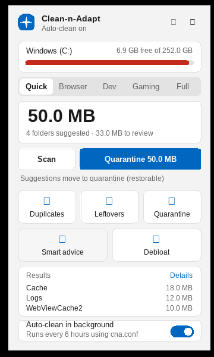

# The on-device model (and the advisor)

Clean-n-Adapt contains a small machine-learning model that **learns from you** which folders on *your* PC are
safe to clean. It runs entirely on your computer, needs no internet and no GPU, and is not a language model.



> Screenshot captured under Wine; the empty squares are icon glyphs that Windows draws with Segoe Fluent Icons.

## 1. What it is, and what it is not

| | |
|---|---|
| **Type** | Multinomial logistic regression (softmax) over ~16,000 hashed sparse features, trained with SGD. |
| **Size** | 3 classes x 16,384 weights = **192 KB** in memory and on disk (`model.bin`). |
| **Training time** | About 70 ms to train from scratch (measured); loading a saved model takes about 4 ms. It is retrained from scratch whenever you teach it something. |
| **Dependencies** | None. Plain C++ in `src/model.cpp`; no ML library. |
| **Network** | Never used. Nothing leaves your PC. |
| **It is not** | A language model, a neural network, or a model trained on other people's computers. |

**Why this and not an LLM.** The question "is this folder a cache, user data, or system data?" is a small
classification problem. A 192 KB linear model answers it in microseconds, its reasons can be shown to you, it fits
the 125 MB budget with room to spare, and it can be retrained instantly from your feedback. An LLM would use most of the
memory budget and could not explain *why* in a checkable way.

## 2. What it predicts and what the app does with it

The model outputs three probabilities for a folder:

| Class | Meaning | Examples |
|---|---|---|
| `regenerable` | Rebuilt automatically; safe to remove | browser/app caches, shader caches, logs, crash dumps, temp files |
| `caution` | Holds something you might want | browser profiles, app settings, saves, documents, photos |
| `keep` | System files, credentials, sync roots, repositories | `WinSxS`, `.ssh`, wallets, `Credentials`, `OneDrive`, `.git` |

A prediction is only a *proposal*. The app turns it into one of three **actions** (`advise()` in `src/model.cpp`):

| Action | What happens |
|---|---|
| `clean` | Offered by `cna recommend`; applying it **moves the folder to quarantine** (restorable), never deletes it |
| `review` | Shown to you; never touched automatically |
| `keep` | Hidden from recommendations and never touched |

### The non-learned safety gate

The learned part never has the last word. In this order:

1. **Your own decision** about that exact folder (from `model feedback` or a restore) always wins.
2. **Sensitive names are never cleaned**: names/parents containing credential, password, wallet, vault, keystore, ssh, gnupg,
   cert, protect, tdata, seed, token, key(s), backup, save(s), ... and `Package Cache` / `Installer`.
3. A `keep` prediction at 50% or more is `keep`.
4. A `regenerable` prediction becomes **`clean` only if it is at least 85% confident _and_** the folder name or its parent looks
   like a cache (cache, temp, tmp, log(s), crash, dump, shader, thumbnail, webcache, ...) **or** you previously marked a folder with
   the same name as regenerable. Otherwise it is downgraded to `review` ("contents look like a cache, but the folder name is
   unfamiliar").
5. Where the deterministic **rules** (the signature table used by `explain`) know the folder, **the rules are authoritative**
   unless the model strongly disagrees (then `review`).

This gate exists because of a real failure found during testing: hex-named blob files look the same in a cache and in
`Microsoft\Credentials` or Telegram's `tdata`, and the model alone called both "regenerable". See section 6.

## 3. What the model looks at

Only **names, sizes and dates**, never file contents. For each folder (`Descriptor` in `src/model.hpp`):

* the folder name (whole word, camel-case words such as `GPU`+`Cache`, and 3-letter fragments), and the parent's name
* where it lives (`appdata-local`, `appdata-roaming`, `programdata`, `program-files`, `windows`, `temp`, `user-profile`)
* up to 40 child names, normalised (`f_0000a1` -> `f_H`, `data_12` -> `data_0`) and the child file extensions
* the file-type mix by bytes (blob / config / database / media / documents / programs / logs / temp / keys ...)
* size, file-count and age buckets; whether it contains executables or an uninstaller; whether an installed app owns it
* a few interactions (name word x location, name word x owned)

## 4. How it learns

1. **Built-in seed.** On first use it trains on ~2,300 examples generated from 145 hand-written folder-name groups
   (`SEEDS` in `src/model.cpp`: 59 regenerable, 44 caution, 42 keep), with varied parents, locations, contents, sizes and ages. This includes
   *hard negatives* (non-cache names that contain cache-like blobs, and cache names that contain data-like files) and 40 invented
   application names so it must lean on contents when the name is unknown.
2. **Your decisions.** Two ways to teach it:
   * `cna model feedback PATH --label regenerable|caution|keep`
   * **Restoring** something that `cna recommend` (or the leftover finder) moved to quarantine counts as "this was not safe to
     clean": it is recorded as `caution` automatically.
3. Each decision is stored in `feedback.tsv` (up to 5,000) and the model is retrained from *seed + all your decisions*
   (your decisions count 4x). `cna model forget PATH` removes one; `cna model reset --yes` returns to the seed.

Retraining from scratch (instead of tweaking weights) keeps the model deterministic and makes "forget" exact.

## 5. Explanations

Every prediction can say why. For a linear model the reasons are exact: the features that pushed the winning class furthest
ahead of the runner-up, e.g.

```text
Model:    caution (99%)   regenerable 1% | caution 99% | keep 0%
Because:  mostly config by size; contains .json files; located in appdata-roaming
```

Whole-word reasons are preferred; character fragments are shown only if nothing better exists.

## 6. How well does it work? (measured, with caveats)

Two different tests, because the first one flatters the model:

| Test | Result |
|---|---|
| **Grouped 5-fold cross-validation on the seed** (`cna model eval`): whole folder names held out, never seen in training | **90.7%** accuracy (2,077 / 2,291). Raw "dangerous" errors (a caution/keep folder called regenerable at >= 85%): **17 of 1,459 (1.2%)**; **0** of them pass the name gate |
| **Hand-built realistic folders** (`tests/model_check.py`, 30 folders I wrote by hand, not from the seed templates) | **11 / 12** real caches recognised as `clean`; **18 / 18** non-caches kept out of `clean` (0 dangerous) |
| **End-to-end advisor + learning** (`tests/advisor_check.py`) | 21 / 21 checks |

**Caveats, stated plainly**

* The seed is *synthetic*: it encodes my knowledge of Windows folders, so the cross-validation number is optimistic.
  The 30-folder check is more honest but still written by the same author. Real accuracy on your PC is unknown until you use it.
* One known miss: a cache whose folder name is generic (for example Spotify's `Data`) is only `review`. That is the gate working as designed.
* The first real-world defect (credentials/tdata called regenerable) was found by that hand-built check, not by the
  cross-validation. Expect more such cases; that is what the gate and your feedback are for.
* Nothing here has been evaluated on a large set of real machines.

## 7. Commands

```text
cna recommend [--min-size 5M] [--limit 25] [--apply --yes] [--json]     what to clean, with reasons
cna explain PATH                                                      rules + model + action for one folder
cna model status                                                      examples, your decisions, size, file
cna model eval                                                        cross-validation report
cna model predict PATH [--json]                                       class, confidence, action, reasons
cna model feedback PATH --label regenerable|caution|keep              teach it
cna model forget PATH                                                 undo one lesson
cna model retrain | reset --yes                                       rebuild / return to the seed
```

`cna recommend` walks `%LOCALAPPDATA%`, `%APPDATA%` and `%PROGRAMDATA%` down to six levels, **looking inside folders that
need review** (so `Google\Chrome\User Data\Default\Cache` is found) and reporting each byte once, at the most specific folder.
`--apply --yes` moves only the `clean` items to quarantine.

## 8. Files

| File (in the state folder) | Contents |
|---|---|
| `model.bin` | 32-byte header (magic `CNAM`, model version, feature count, class count, example/feedback counts, timestamp, checksum) + 49,152 float32 weights (196,640 bytes in total) |
| `feedback.tsv` | One line per decision: path key, label, time, and the folder's descriptor (names, extensions, sizes) so it can be replayed |

A stored model is discarded and rebuilt automatically if its header, version or checksum does not match.

## 9. Extending it

* Add or correct knowledge: edit the `SEEDS` table in `src/model.cpp`, bump `MODEL_VERSION`, run `cna model eval` and `python3 tests/model_check.py ./cna`.
* Add a feature: extend `features()` and `pretty_feature()` (so it can be explained), bump `MODEL_VERSION`.
* The language-model hook (`src/llm_stub.cpp`) is still an empty stub; this model does not use it.
